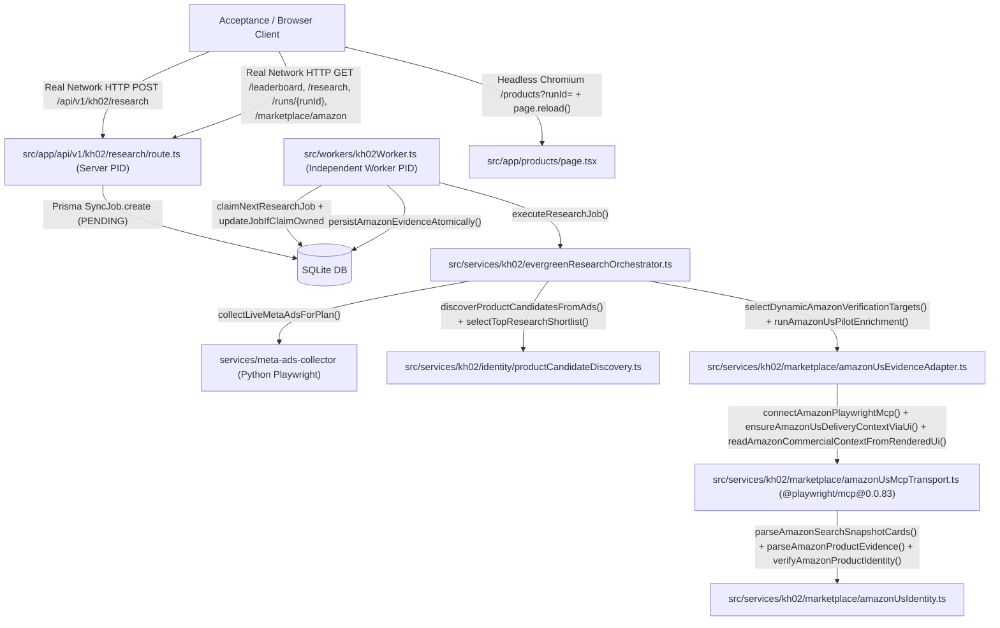

# KH-02 V12.4.3.7.1 — Pre-Edit Call Graph & Architecture Audit

- **Repository**: `quocan050302/Shopify-Search`
- **Branch**: `feature/kh02-walmart-us-jina-reader-v12.4.3.5.1`
- **Tested Code SHA (`CODE_SHA`)**: `abc78cb97b627c49849db389e6920e19c46c58ae`
- **Tree SHA**: `28d7143d96415a88b63796634c4e830630126d5d`
- **Merge-Base with `origin/QA`**: `fbe51a06ab8354c886d0415a9599f977c83caabc`

## 1. End-to-End Call Graph (Real Network HTTP -> Independent Worker Process -> Live Meta -> Candidate Discovery -> Amazon US UI Commercial & MCP Search/PDP -> SQLite DB -> Real HTTP GET -> Headless Chromium UI)

## 2. File & Line-Range Inventory of V12.4.3.7.1 Closure Modules
1. **P0-A (Amazon US Location ZIP 95829 & USD Commercial Context via Rendered UI)**:
   - `src/services/kh02/marketplace/amazonUsMcpTransport.ts` (`ensureAmazonUsDeliveryContextViaUi`, `readAmazonCommercialContextFromRenderedUi`, `#twotabsearchtextbox` readiness wait, `#nav-global-location-popover-link` modal, `#GLUXZipUpdateInput` `95829`, buybox `.aok-offscreen` / `.a-offscreen` / `[data-asin-currency-code]`, zero internal `/portal-migration/hz/glow/address-change` fetch).
2. **P0-B (Standalone Reference / Fixture / Live Evidence Integrity)**:
   - `src/services/kh02/marketplace/REFERENCE_AMAZON_STANDALONE_2026_11_02.json` & `src/services/kh02/marketplace/amazonUsIdentity.ts` (`loadStandaloneAmazonReferenceManifest`, `EXTERNAL_REFERENCE_OR_FIXTURE_DOWNGRADED_FROM_LIVE` guard).
3. **P0-C (Real Network HTTP Server Process -> Separate Worker OS Process)**:
   - `src/workers/kh02Worker.ts` (`--poll-interval-ms` standalone daemon loop), `scripts/kh02/runAcceptanceV12_4_3_7_1.ts` (`serverPID != workerPID != acceptancePID`), `scripts/kh02/validateClosureV12_4_3_7_1.ts`.
