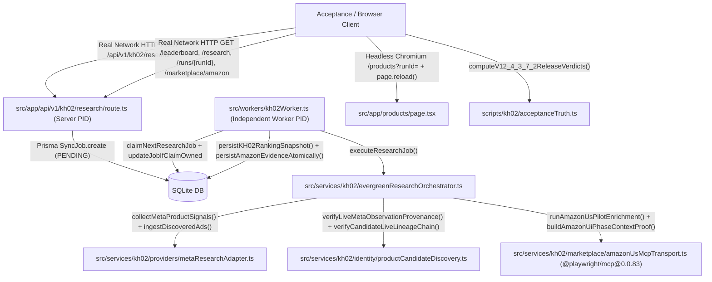

# KH-02 V12.4.3.7.2 — Call Graph & Field Provenance Audit

- **Repository**: `quocan050302/Shopify-Search`
- **Branch**: `feature/kh02-walmart-us-jina-reader-v12.4.3.5.1`
- **Tested Code SHA (`CODE_SHA`)**: `164f9d0d1a6207cbb5a00490a7154396b5d07836`
- **Tree SHA**: `d971d0d04471f052fd915aa50d8e3f2b55aef7ad`
- **Merge-Base with `origin/QA`**: `fbe51a06ab8354c886d0415a9599f977c83caabc`

## 1. End-to-End Call Graph (Real Network HTTP -> Independent Worker PID -> Live Meta Provenance -> Candidate Lineage -> Amazon 6-Phase UI Context -> SQLite -> HTTP GET -> Headless Chromium DOM)

## 2. Field Provenance & Zero-Default Hardening Inventory (P0-A .. P0-E)
1. **P0-A (Central Fail-Closed Verdict Computation)**:
   - `scripts/kh02/acceptanceTruth.ts` -> `computeV12_4_3_7_2ReleaseVerdicts` computes every gate from measured receipts and rejects missing/stale/contradictory artifacts.
2. **P0-B (Real Live Meta Query Execution & Observation-to-Ad-to-Candidate Lineage)**:
   - `src/services/kh02/evergreenResearchOrchestrator.ts` -> attaches authentic `queryOutcomes` onto `providerTelemetry.META_ADS` and never synthesizes `requestStarted=true` for unexecuted planned queries.
   - `src/services/kh02/identity/productCandidateDiscovery.ts` -> `verifyLiveMetaObservationProvenance` and `verifyCandidateLiveLineageChain` verify `runId`, `workspaceId`, `queryId`, `providerRequestId`, and `CompetitorAd` DB ownership.
3. **P0-C (Amazon UI 6-Phase Context Proof & Contradiction Detector)**:
   - `src/services/kh02/marketplace/amazonUsMcpTransport.ts` -> `buildAmazonUiPhaseContextProof` and `validateAmazonUiContextProofConsistency` reconcile `phase1_initial_home` .. `phase6_post_session_close` without `?? true` or hardcoded `stepsExecuted`.
4. **P0-D (Real Network HTTP Server Process -> Separate Worker OS Process -> DB/API/UI Parity)**:
   - `scripts/kh02/runAcceptanceV12_4_3_7_1.ts` & `scripts/kh02/runAcceptanceV12_4_3_7_2.ts` -> zero `|| "PENDING"`, `|| "COMPLETED"`, `|| 4`, or `|| "PASSED"` fallbacks.
5. **P0-E (Historical DEV & HOLDOUT Point-in-Time Replay & Truthful Business Verdicts)**:
   - `scripts/kh02/runBacktestV12_4_3_4_2.ts` & `scripts/kh02/acceptanceTruth.ts` -> separates `POINT_IN_TIME_INTEGRITY_PASS` from `HISTORICAL_PROVIDER_PARITY_NOT_PROVEN` (`VACUOUS_OR_UNPROVEN`) and `INSUFFICIENT_HISTORICAL_EVIDENCE`.
