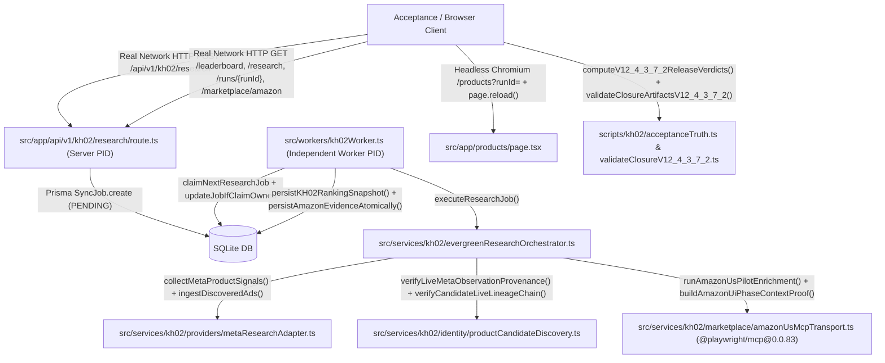

# KH-02 V12.4.3.7.3 — Call Graph & Function Change Inventory

- **Repository**: `quocan050302/Shopify-Search`
- **Branch**: `feature/kh02-walmart-us-jina-reader-v12.4.3.5.1`
- **Tested Code SHA (`CODE_SHA`)**: `7577a9bfd58817053d23c8a5b134ac0f138fc7d2`
- **Tree SHA**: `452eb8e5d93e4cccafb81321479d4d8ef340d925`
- **Merge-Base with `origin/QA`**: `fbe51a06ab8354c886d0415a9599f977c83caabc`

## 1. End-to-End Call Graph (Real Network HTTP -> Independent Worker PID -> Live Meta Provenance -> Candidate Lineage -> Amazon 6-Phase UI Chronology -> SQLite -> HTTP GET -> Headless Chromium DOM)

## 2. V12.4.3.7.3 Function Change Inventory (P1-A .. P1-F & P2)
1. **P1-A (E2E Per-Spec Receipt Validation)**:
   - `scripts/kh02/acceptanceTruth.ts` -> `validatePerSpecE2EReceipts` verifies all 12 canonical E2E spec receipts (`exitCode === 0`, `classification === "PASS"`, `totalTests > 0`, `failedTests === 0`, `startedAt <= endedAt`, `ownedPidsReconciled === true`, `sourceSha === expectedCodeSha`, and exact sum equality with summary counters).
2. **P1-B (Final Verdict Chronology & Mandatory Late-Stage Receipts)**:
   - `scripts/kh02/acceptanceTruth.ts` -> `computeV12_4_3_7_2ReleaseVerdicts` requires non-null `typecheckAndBuild`, `mutationSuite`, and `resourceAndOrphanGuard` (`mutationSuite.completedAt <= evaluatedAt`, zero `"Mutations:pending"`).
3. **P1-C (Amazon 6-Phase Raw Observation Chronology)**:
   - `src/services/kh02/marketplace/amazonUsMcpTransport.ts` -> `buildAmazonUiPhaseContextProof`, `validateAmazonUiContextProofConsistency`, and `isValidAmazonRawSnapshotHash` enforce `phase1 <= phase2 <= phase3 <= phase4 <= phase5 <= lastToolCompletedAt <= closeStartedAt <= closeFinishedAt` using real pre-close tool observation timestamps and non-phony snapshot hashes.
4. **P1-D (Amazon US ZIP 95829 & Explicit USD Strict Booleans)**:
   - `src/services/kh02/marketplace/amazonUsMcpTransport.ts` & `scripts/kh02/acceptanceTruth.ts` -> removes `?? true` fallbacks on `finalEffectiveUsDeliveryVerified` and `finalEffectiveCurrencyUsdVerified`.
5. **P1-E (Browser DOM Candidate ID Array Fail-Closed Parity)**:
   - `src/services/kh02/persistence/kh02PersistenceService.ts` & `scripts/kh02/acceptanceTruth.ts` -> removes `: dbIds` fallback when `domCandidateIdsBeforeReload` or `domCandidateIdsAfterReload` is missing.
6. **P1-F (Live Meta Provenance & Lineage Count Reconciliation)**:
   - `scripts/kh02/acceptanceTruth.ts` -> `reconcileLiveMetaLineageCounts` reconciles completed queries, validated live observations, candidate-associated observations, persisted ads, and Top-3 candidate lineage chains.
7. **P2 (Independent Raw-Evidence Validator & 98-Case Physical Mutation Suite)**:
   - `scripts/kh02/validateClosureV12_4_3_7_2.ts` -> independently validates all 28 V12.4.3.7.3 artifacts and executes 98 physical source + artifact mutations covering `A01..A42`.
