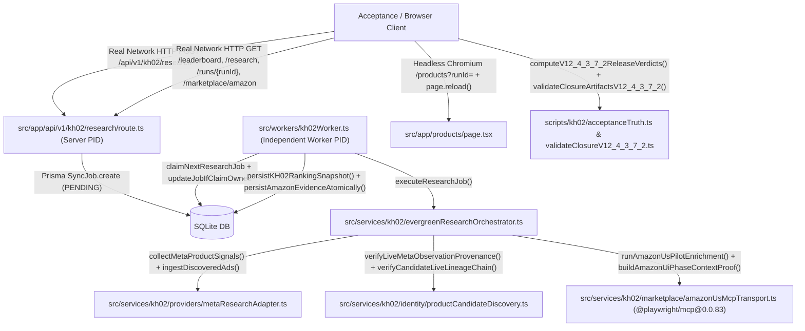

# KH-02 V12.4.3.7.4 — Call Graph & Function Change Inventory

- **Repository**: `quocan050302/Shopify-Search`
- **Branch**: `feature/kh02-walmart-us-jina-reader-v12.4.3.5.1`
- **Tested Code SHA (`CODE_SHA`)**: `03886a6402b63509758ea434605bea0967297f8a`
- **Tree SHA**: `2124fcbae166220cecdd6acc9925e289b06dd12c`
- **Merge-Base with `origin/QA`**: `fbe51a06ab8354c886d0415a9599f977c83caabc`

## 1. End-to-End Call Graph (Real Network HTTP -> Independent Worker PID -> Live Meta Provenance -> Candidate Lineage -> Amazon 6-Phase UI Chronology -> SQLite -> HTTP GET -> Headless Chromium DOM)

## 2. V12.4.3.7.4 Engineering Invariants (P0-A .. P0-D)
1. **P0-A (Zero Transient Release PASS)**:
   - Acceptance lifecycle managed via explicit `RUN_STATE.json` state machine.
   - Removed pre-mutation provisional 24 seed; `publishFinalVerdictAfterEvidenceBarrier()` emits `24_FINAL_ROUTE_SPECIFIC_VERDICT_MATRIX.json` only AFTER 118-case physical negative mutations complete cleanly.
   - Atomic writes prevent partial/corrupted files during process interrupts.
2. **P0-B (Meaningful Physical Negative Mutations with Control vs. Target Transition)**:
   - Upgraded to 118 physical negative mutations (8 source + 42 A01..A42 + 48 baseline + 20 adversarial V12.4.3.7.4 mutations).
   - Inconclusive baselines detected and rejected; each mutation verified to transition the target check ID from PASS in control to FAIL in mutant.
3. **P0-C (Non-Circular 3-Commit S -> E -> A DAG & True Post-Push Attestation)**:
   - Manifest 25 hashes immutable execution artifacts (00..22, 24, 26) and excludes 23, 25, 27, 28.
   - Evidence Commit E committed and pushed first.
   - Attestation Commit A commits `27_COMMIT_PUSH_REMOTE_HEAD_ATTESTATION.json` citing pushed SHA of E without self-referential cycle.
4. **P0-D (7-Stage Crash Injection Simulation Proof)**:
   - All 7 failure stages tested to ensure zero outward release PASS is ever emitted upon unexpected termination.
