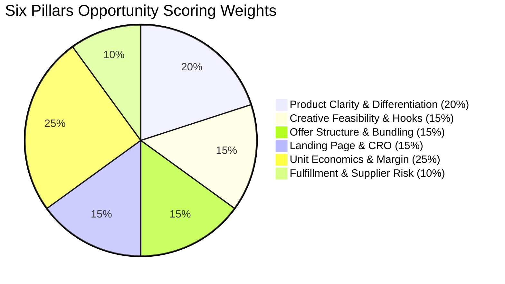

# KH-01 — Unit Economics & Six-Pillar Opportunity Methodology
**SWAI V11.4 — Competitor Product, Offer & Funnel Intelligence Engine**

## 1. Unit Economics Mathematical Model

The function `calculateOrderEconomics(input: ProductEconomicsScenarioInput)` in `src/lib/economics.ts` replaces guesswork with deterministic financial modeling for a single acquired customer order:

### 1.1 Formulas
1. **Net Selling Revenue ($)**:
   $$\text{Net Revenue} = \text{Selling Price} \times \text{Units} - \text{Discount} + \text{Shipping Charged to Customer}$$

2. **Total Variable Costs ($)**:
   $$\text{COGS} = \text{Supplier Unit Cost} \times \text{Units}$$
   $$\text{Payment Fees} = (\text{Net Revenue} \times \text{Fee\%}) + \text{Fixed Fee}$$
   $$\text{Shipping Cost} = \text{Actual Shipping Cost Paid by Store}$$
   $$\text{Return Reserve} = \text{Net Revenue} \times \text{Expected Return Rate} \times (1 - \text{Salvage Value\%})$$
   $$\text{Total Costs Before Ads} = \text{COGS} + \text{Shipping Cost} + \text{Fulfillment} + \text{Payment Fees} + \text{Return Reserve}$$

3. **Contribution Margin Before Ads ($)**:
   $$\text{Contribution Before Ads} = \text{Net Revenue} - \text{Total Costs Before Ads}$$

4. **Break-Even Metrics**:
   $$\text{Break-Even CPA} = \text{Contribution Before Ads}$$
   $$\text{Break-Even ROAS} = \frac{\text{Net Revenue}}{\text{Contribution Before Ads}} \quad (\text{if Contribution} > 0)$$

5. **Target Profit & Allowable Acquisition**:
   $$\text{Target CPA} = \text{Contribution Before Ads} - \text{Target Profit per Order}$$
   $$\text{Target ROAS} = \frac{\text{Net Revenue}}{\text{Target CPA}} \quad (\text{if Target CPA} > 0)$$

---

## 2. Six-Pillar Opportunity Assessment

The opportunity engine aggregates empirical data across six independent pillars:

### Pillar Definitions:
1. **Product (20 points)**:
   - Evaluates problem clarity, category maturity, and identity confidence.
2. **Creative (15 points)**:
   - Evaluates demonstration feasibility, observed hook variety, and CTA clarity.
3. **Offer (15 points)**:
   - Evaluates pricing transparency, bundling potential, and discount structure.
4. **Landing Page (15 points)**:
   - Evaluates conversion architecture, above-the-fold clarity, and message match.
5. **Economics (25 points)**:
   - Evaluates contribution margin before ads, break-even ROAS viability, and acquisition headroom.
6. **Fulfillment (10 points)**:
   - Evaluates parcel weight, transit lead time, fragile/hazmat constraints, and return complexity.

---

## 3. Strict Decision Gates & Operator Override Rules

A high composite Opportunity Score **CANNOT** bypass fundamental business gates.
The function `evaluateSmallTestReadiness(assessment)` enforces 6 critical gates:

| Gate | Condition Required for Small Test | Failure Result |
|---|---|---|
| **Gate 1: Product Identity** | Must have `EXACT` or `PROBABLE` identity confidence | Fails Gate |
| **Gate 2: Customer Problem** | Must identify a clear customer pain point | Fails Gate |
| **Gate 3: Offer Snapshot** | Must have at least 1 verified competitor offer snapshot | Fails Gate |
| **Gate 4: Unit Economics** | Complete scenario with positive Contribution Before Ads | Fails Gate |
| **Gate 5: Supplier Evidence** | Verified supplier quote on file (COGS unverified is blocked) | Fails Gate |
| **Gate 6: Fulfillment Feasibility** | Fulfillment risk must NOT be `HIGH` | Fails Gate |

### Algorithmic Recommendation vs User Decision:
- If all 6 gates pass: Algorithm recommends `TEST_CANDIDATE`.
- If critical evidence is missing: Algorithm recommends `RESEARCH_MORE`.
- If economics are negative: Algorithm recommends `REJECT`.
- **Operator Override**:
  - An operator can manually record `TEST_CANDIDATE` on an ineligible product.
  - SWAI UI explicitly renders: `[USER OVERRIDE — ALGORITHMIC REQUIREMENTS NOT MET]`.
  - The authoritative algorithm recommendation and underlying evidence remain immutable.
