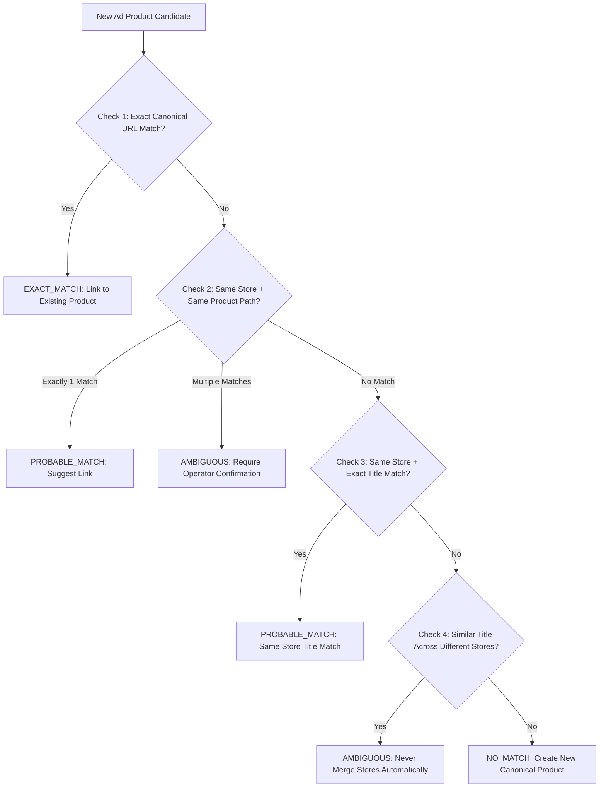

# KH-01 — Product, Store & Offer Identity Engine
**SWAI V11.4 — Competitor Product, Offer & Funnel Intelligence Engine**

## 1. Entity Distinction: Advertisement vs Product vs Offer

In previous versions, an advertisement, a product, and an offer were often conflated into a single database row. In SWAI KH-01, these three entities are strictly distinct:

1. **Advertisement (`CompetitorAd`)**:
   - A single creative artifact deployed by an advertiser on a distribution network (Meta Facebook Ads, Instagram, TikTok).
   - Contains headline, primary text, video/image media, Meta Library ID, launch date, and click-through link.
   - An advertiser may run 50 distinct ads for the same product.

2. **Product (`ResearchProduct`)**:
   - The underlying physical or digital consumer item (e.g. *Electrostatic Pet Hair Remover Roller*).
   - Solves a specific customer problem.
   - Sold across multiple independent competitor stores and promoted by dozens of advertisers.

3. **Offer (`CompetitorOfferSnapshot`)**:
   - The commercial bundle and financial terms under which the product is sold at a specific point in time.
   - Examples:
     - *Single unit at $29.99 with free shipping*
     - *Pack of 2 for $49.99 + extra lint refills*
     - *Buy 2 Get 1 Free at $59.90*
   - Offers change frequently while product identity remains stable.

---

## 2. URL Canonicalization Algorithm

Matching products by raw ad destination URLs creates redundant duplicates due to tracking parameters (`utm_source`, `utm_medium`, `fbclid`, `gclid`).

The `canonicalizeProductUrl(rawUrl: string)` function enforces strict normalization:
1. Strips tracking query parameters (`utm_*`, `fbclid`, `gclid`, `_ga`, `ref`, `ad_id`, `campaign_id`).
2. **Preserves meaningful product variant parameters** (`variant=`, `id=`, `sku=`).
3. Normalizes protocol (`http` to `https`) and lowercases hostnames.
4. Strips redundant trailing slashes while preserving meaningful path segments (`/products/pet-hair-roller`).
5. Generates a stable comparison key: `hostname + pathname + sorted meaningful query params`.

---

## 3. Safe Product Matching Priority

The function `matchExistingResearchProduct(candidate, workspaceId)` prevents incorrect merging of distinct products:

**Critical Invariant**: Cross-store products with similar titles are **NEVER** merged automatically. They are surfaced as suggestions, requiring explicit operator action.

---

## 4. Commerce Platform Evidence

The `verifyCommercePlatformEvidence(inspection)` function replaces superficial substring checks with multi-factor storefront technical indicators:

- **Shopify Confirmed (`SHOPIFY_CONFIRMED`)**:
  - `myshopify.com` domain suffix, OR
  - Verified `cdn.shopify.com` asset paths, `Shopify.theme` global objects, and `/cart.js` or `/products.json` endpoints.
- **Shopify Possible (`SHOPIFY_POSSIBLE`)**:
  - Shopify-specific CSS class names or meta tags without definitive root CDN proof.
- **Other (`OTHER`)**:
  - Distinct WooCommerce (`wp-content/plugins/woocommerce`), Magento, or BigCommerce signatures detected.
- **Unknown (`UNKNOWN`)**:
  - No conclusive platform signature observed.

---

## 5. Offer Extraction & Comparison

The `offerExtractionService.ts` parses public page content into structured offers:
1. **JSON-LD Schema.org `Product` & `Offer`**:
   - `price`, `priceCurrency`, `availability`, `itemCondition`.
2. **DOM Regular Expression Heuristics**:
   - Visible prices, compare-at / original prices (identified by strike-through tags, `was-price`, or `original` snippets).
3. **Promotional Term Analysis**:
   - Quantity discounts (Buy 2 Get 1 Free, 20% off 2 units).
   - Free shipping thresholds (e.g. *Free shipping over $50*).
   - Satisfaction guarantees (30-day money-back guarantee).
4. **Offer Comparison**:
   - Evaluates unit price, effective per-unit price in bundles, discount percentages, and shipping subsidies side by side across competing stores.
