# SWAI KH-02 — Baseline Architecture & System Protection Specification
**Document ID:** `KH02_00_BASELINE_ARCHITECTURE`  
**Starting Commit SHA:** `354256b616bfbb04e605fe0620343f2a3b4ffd0a`  
**Starting Branch:** `feature/v11-meta-collector-remove-muse`  
**Audited Foundation:** KH-01 / SWAI V11.6.1.1  
**Target Module:** KH-02 — Evergreen Winning Products Intelligence (V12.0)  
**Date:** October 26, 2026  

---

## 1. Executive Baseline & Audit Summary

This document establishes the architectural baseline, reusable system components, data contracts, and non-negotiable safety constraints before the implementation of **SWAI KH-02 (Evergreen Winning Products Intelligence)**.

### 1.1 Non-Negotiable Protection Rules
1. **Preserve KH-01 Completely:**
   - MetaAdsCollector Python MCP (`services/meta-ads-collector`) and JSON-RPC transport remain untouched.
   - Meta Discovery Research pipeline, Discovery Worker, and `DiscoveryRun` lifecycle remain intact.
   - Server-side research authorization and multi-tenant workspace isolation must be preserved fail-closed.
   - SQLite/Prisma persistence layer, tables, and relationships are preserved with zero destructive schema migrations.
   - Ads Explorer, existing provider registry, source provenance, and product intelligence detail pages must not be broken or deleted.
2. **Preserve Business Entity Distinctions:**
   - **Advertisement:** Individual creative variant, copy, platform ID (`CompetitorAd`).
   - **Product:** Underlying customer-facing item (`ResearchProduct`).
   - **Offer:** Commercial terms, price, guarantee, bundle, shipping terms (`CompetitorOfferSnapshot`).
   - *Rule:* Multiple ads pointing to the same product do not create multiple products. Cross-store products with similar titles are **never automatically merged** without explicit evidence and review.
3. **No Fabricated Demand or Fictional Winners:**
   - A single viral TikTok video does not establish that a product is evergreen.
   - Missing data remains `null` or `UNKNOWN` — never substituted with median averages or fabricated metrics.
   - Client-supplied recommendations are never accepted as authoritative.
   - Zero unapproved API credit consumption.

---

## 2. Inventory of Reusable Services & Contracts

### 2.1 Ad Discovery & Collection Layer
| File Path | Primary Functions / Symbols | Reusable Capability |
| :--- | :--- | :--- |
| `src/services/ads/adService.ts` | `searchCompetitorAds`, `searchAuthorizedCompetitorAds`, `getAdvertisementDetails`, `upsertCompetitorAd`, `importAdvertisementForWorkspace` | Primary query and persistence layer for competitor ads backed by genuine observation records. |
| `src/services/discovery/providerRegistry.ts` | `listDiscoveryProviders`, `getDiscoveryProvider`, `registerDiscoveryProvider`, `listAvailableDiscoveryProviders` | Discovery provider registration with strict zero-cost priority hierarchy. |
| `src/services/discovery/providerContract.ts` | `AdDiscoveryProvider`, `DiscoveryQuery`, `ProviderAvailabilityResult`, `DiscoveredAdCandidate` | Standard interface for automated ad discovery providers. |
| `src/services/discovery/providers/metaAdsCollectorProvider.ts` | `MetaAdsCollectorProvider` | Production-tested Meta Ad Library provider via local Python MCP client. |
| `src/services/discovery/metaCollector/metaCollectorMcpClient.ts` | `MetaCollectorMcpClient` | Native JSON-RPC transport client for self-hosted MetaAdsCollector server. |
| `src/services/discovery/providers/tiktokTopAdsProvider.ts` | `TiktokTopAdsProvider` | TikTok Top Ads provider adapter. |
| `src/services/discovery/providers/tiktokOfficialProvider.ts` | `TiktokOfficialProvider` | Official TikTok Commercial Content Library provider. |
| `src/services/discovery/providers/apifyTopAdsProvider.ts` | `ApifyTopAdsProvider` | Paid Apify provider (disabled by default; requires explicit authorization). |

### 2.2 Product Identity, Linking & Research Authority
| File Path | Primary Functions / Symbols | Reusable Capability |
| :--- | :--- | :--- |
| `src/services/products/productService.ts` | `saveAdProductCandidate`, `calculateProductResearchTrend`, `canonicalizeProductUrl`, `matchExistingResearchProduct`, `extractDomainFromUrl` | Atomic candidate creation, URL canonicalization, and safe deduplication. |
| `src/services/research/productIdentityService.ts` | `discoverProductCandidatesFromAds`, `getProductAdvertisingProfile`, `resolveCandidateStoreDomain` | Groups competitor ads by landing page/advertiser to extract product candidates without ad fragmentation. |
| `src/services/research/researchAuthService.ts` | `resolveAuthorizedResearchContext`, `assertProductWorkspaceAccess`, `assertAdWorkspaceAccess`, `assertRunWorkspaceAccess`, `ResearchAccessContext` | Security boundary enforcing workspace isolation and rejecting forged actor headers. |

### 2.3 Opportunity Assessment, Longevity & Scoring Engines
| File Path | Primary Functions / Symbols | Reusable Capability |
| :--- | :--- | :--- |
| `src/services/evergreen/evergreenScoring.ts` | `calculateAdLongevityScore`, `calculateEvergreenProductScore`, `calculateDemandStability`, `detectProductSeasonality`, `EVERGREEN_FORMULA_VERSION = "7.0.0"` | Historical demand stability, seasonality classification, and ad persistence scoring. |
| `src/services/evergreen/longevityEngine.ts` | `calculateAdLongevity`, `LONGEVITY_ENGINE_VERSION = "7.0.0"` | Calendar age calculation, observation coverage analysis, and continuity confidence. |
| `src/services/scoring/scoringEngine.ts` | `calculateAdScore`, `calculateResearchScore` | Multi-dimensional scoring for ad copy, creative angle, and hook quality. |
| `src/services/research/opportunityAssessmentService.ts` | `calculateOpportunityAssessment`, `SixPillarOpportunityInput`, `ProductOpportunityAssessment`, `PillarAssessment` | 6-pillar business assessment (Product, Creative, Offer, Landing Page, Economics, Fulfillment). |
| `src/lib/economics.ts` | `calculateEconomics`, `deriveRecommendation`, `roundCurrency`, `EconomicsResult` | Canonical unit margin engine with Break-even CPA, Break-even ROAS, and zero-margin hard rejection. |

### 2.4 Media Resolution & Playback Strategy
| File Path | Primary Functions / Symbols | Reusable Capability |
| :--- | :--- | :--- |
| `src/services/video/videoSourceResolver.ts` | `resolveVideoSource`, `isStockImage`, `isSampleOrFakeMedia`, `isSyntheticAdId`, `VideoPlaybackStrategy` | Determines safe playback strategy (TikTok oEmbed, Direct HTML5, Open Source link). Rejects sample/synthetic media. |
| `src/services/video/tiktokEmbedService.ts` | `getTikTokOEmbed`, `formatTikTokEmbedUrl` | Official TikTok oEmbed integration for public video playback. |

### 2.5 Security, Budgets & Credentials
| File Path | Primary Functions / Symbols | Reusable Capability |
| :--- | :--- | :--- |
| `src/services/credentials/credentialService.ts` | `resolveAndVerifyActiveModel`, `getMaskedCredentials`, `testProviderConnection` | Server-side credential storage in `.env.local`; prevents client leakage. |
| `src/services/providers/budgetService.ts` | `getProviderBudget`, `authorizePaidApiCall`, `ProviderBudgetConfig` | Zero-cost default protection; caps monthly usage and blocks unapproved charges. |

---

## 3. Prisma Data Models & Model Relationships

The SQLite database (`dev.db`) contains 42 models. The core models reused by KH-02 are:

```mermaid
erDiagram
    Workspace ||--o{ WorkspaceMember : "has"
    Workspace ||--o{ DiscoveryRun : "owns"
    Workspace ||--o{ ResearchEvidence : "owns"
    Workspace ||--o{ ResearchDecision : "owns"

    CompetitorStore ||--o{ ResearchProduct : "hosts"
    CompetitorStore ||--o{ CompetitorAd : "associated with"

    Advertiser ||--o{ CompetitorAd : "runs"
    
    CompetitorAd ||--o{ AdMediaAsset : "contains"
    CompetitorAd ||--o{ AdObservation : "observed via"
    CompetitorAd ||--o{ AdMetricObservation : "metrics"
    CompetitorAd ||--o{ AdProductLink : "links to"
    CompetitorAd ||--o{ DiscoveryRunAd : "ingested by"

    ResearchProduct ||--o{ AdProductLink : "promoted by"
    ResearchProduct ||--o{ ProductPriceObservation : "price history"
    ResearchProduct ||--o{ ProductDemandObservation : "time series"
    ResearchProduct ||--o{ ProductCreativeVariant : "angles"
    ResearchProduct ||--o{ EvergreenProductScore : "legacy scores"
    ResearchProduct ||--o{ CompetitorOfferSnapshot : "offers"
    ResearchProduct ||--o{ LandingPageSnapshot : "pages"
    ResearchProduct ||--o{ ProductEconomicsScenario : "scenarios"
    ResearchProduct ||--o{ SupplierQuote : "quotes"
    ResearchProduct ||--o{ FulfillmentAssessment : "fulfillment"
    ResearchProduct ||--o{ ProductOpportunityAssessment : "assessments"

    DiscoveryRun ||--o{ DiscoveryRunAd : "contains"
```



### 3.1 Entity Cardinality & Semantics
- **`ResearchProduct`:** Does not directly store a `workspaceId`; multi-tenant workspace ownership is established through associated evidence, discovery runs, decisions, and watchlist records.
- **`ProductDemandObservation`:** Stores historical time-series data with fields `keyword`, `region`, `periodStart`, `periodEnd`, `demandValue` (0-100 relative index), and `source` (`GOOGLE_TRENDS_CSV`, `USER_MANUAL`, `PROVIDER_API`).
- **`ProductOpportunityAssessment`:** Persists multi-pillar evaluations with versioning (`methodologyVersion`).
- **`EvergreenProductScore`:** Retains legacy V7.0 score records; must not be overwritten or modified by KH-02 V12.0 scoring.

---

## 4. UI Layer Baseline

### 4.1 `/products` (`src/app/products/page.tsx`)
- Current State: Grid of `ResearchProduct` cards with domain, price, category filter, search, and link to Product Intelligence.
- KH-02 Transformation Target: Convert into the **Evergreen Opportunity Leaderboard** featuring:
  - Top 3 Podium Rows (Gold #1, Ice Blue #2, Coral #3).
  - Clean vertical ranking hierarchy with rounded dark-purple cards.
  - Video/image thumbnail preview with platform badges.
  - Multi-source observation summary badges (Meta, TikTok Ads, TikTok Organic, Google Ads).
  - Search topic, lookback window (30D, 90D, 180D, 365D), and category filters.
  - Remaining candidates ranked #4 and below.
  - Preserved access to historical product intelligence.

### 4.2 `/products/[id]/intelligence` (`src/app/products/[id]/intelligence/page.tsx`)
- Current State: 7 functional tabs: `Product`, `Creative`, `Offer`, `Funnel`, `Economics`, `Fulfillment`, `Decision`.
- KH-02 Transformation Target: Preserve all 7 existing tabs and add KH-02 intelligence panels:
  - `Evergreen Analysis` (Demand stability curve, seasonal trends, sustainability explanation).
  - `Cross-Platform Evidence` (Unified Meta, TikTok, Google observation timeline).
  - `TikTok Organic` (Real public videos, view counts, engagement ratio, creator diversity).
  - `Google Ads` (Google Transparency Center advertiser and creative observations).
  - `Store Fit & Brandability` (Niche coherence, SKU expansion, bundling potential).

---

## 5. Regressions to Protect & Failure Invariants

| Invariant Area | Requirement | Failure Mode Prevented |
| :--- | :--- | :--- |
| **Meta Discovery** | Python MCP server (`services/meta-ads-collector`) must continue serving live Meta requests without alteration. | Breaking the working KH-01 live Meta collection pipeline. |
| **Zero Unauthorized Spend** | Paid APIs (Apify, paid tiers) must remain disabled unless explicitly authorized in `.provider-budgets.json`. | Unexpected credit card charges or unbudgeted API consumption. |
| **Fail-Closed Security** | All KH-02 routes must resolve `ResearchAccessContext` and verify tenant workspace ownership. | Cross-tenant data leakage or unauthorized workspace manipulation. |
| **Product Deduplication** | Matching must use URL canonicalization and store domains. Similar titles must not merge across different stores. | Data corruption; destroying separate competitor storefront records. |
| **Economics Integrity** | Zero or negative contribution margins must produce immediate hard `REJECTED`. | False `READY_FOR_SMALL_TEST` recommendations on money-losing products. |
| **Score Immutability** | Legacy `EvergreenProductScore` (formula 7.0.0) records must remain intact. KH-02 scores use `KH02_SCORE_VERSION = "12.0.0"`. | Corrupting historical audit trails or changing meaning of past research. |
| **Truthful Upstream Signals** | Blocked or unconfigured sources must be reported as `BLOCKED_SOURCE` or `NOT_CONFIGURED` (never fake zeros or mock data). | Presenting absence of data as evidence of absence. |

---

## 6. Implementation Phasing Strategy

```text
PHASE 0: Baseline Architecture & System Protection (This Document)
PHASE 1: Multi-Source Feasibility & Adapters (Meta, TikTok Ads, TikTok Organic, Google Transparency)
PHASE 2: Product Candidate Extraction & Cross-Platform Matching Engine
PHASE 3: Historical Demand & Temporal Stability Engine (Google Trends + Time Series)
PHASE 4: KH-02 Evergreen Opportunity Scoring & Confidence Service (V12.0.0)
PHASE 5: Winning Products Leaderboard UI (/products) with Top 3 Visual Direction
PHASE 6: Product Intelligence Integration & Sustainability Workspace
PHASE 7: Comprehensive Testing (Unit, Integration, Security, and Browser Verification)
PHASE 8: Real Data Acceptance & Evidence Reconciliation
PHASE 9: Final Acceptance Documentation & Git Release
```

All implementation steps will strictly follow this dependency order with verifiable checkpoints.
