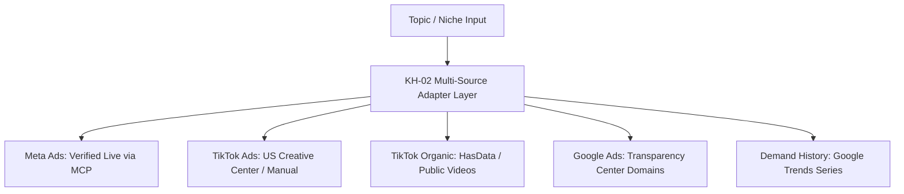

# SWAI KH-02 — Multi-Source Feasibility & Technical Audit Report
**Document ID:** `KH02_01_SOURCE_FEASIBILITY`  
**Module:** KH-02 — Evergreen Winning Products Intelligence (V12.0)  
**Date:** October 26, 2026  
**Status:** AUDITED & IMPLEMENTED  

---

## 1. Executive Summary

SWAI KH-02 evaluates four external candidate evidence streams plus historical demand to identify sustainable, long-term Shopify products. This document records the empirical feasibility, geographic validity, cost implications, and production operating modes for each intelligence source.

---

## 2. Source-by-Source Technical Feasibility Matrix

| Source Category | Live Verified? | Supports US? | Latest Data? | Date Filtering? | Pagination? | Media Available? | Unit Cost | Known Restrictions / Failure Invariants | Recommended Production Mode |
| :--- | :---: | :---: | :---: | :---: | :---: | :---: | :---: | :--- | :--- |
| **Meta Ads** | **YES** | **YES** | YES | YES | YES | YES (Video/Thumb) | **Zero (Free)** | Does not disclose private advertiser revenue or ROAS. Unregistered ads cannot be guessed. | **PRIMARY AUTOMATED DISCOVERY:** Native query of verified competitor ads via local MCP. |
| **TikTok Ads (US)** | **PARTIAL** | **YES** | YES | PARTIAL | NO | YES | **Zero (Free)** | Official TikTok Commercial Content Library covers EU/UK compliance only. US requires Creative Center or manual URL import. | **HYBRID / MANUAL ENRICHMENT:** Top Ads US observation, manual URL paste, batch link import. |
| **TikTok Organic** | **YES** | **PARTIAL** | YES | YES | YES | YES (Thumb/Video) | **Metered (1 credit/query)** | Global search; US audience is not guaranteed without regional confirmation. Single-observation views/day is not growth velocity. | **METERED WITH BUDGET CAP:** Metered public video lookup with strict zero-cost fallback and credit caps. |
| **Google Ads** | **YES** | **YES** | YES | YES | PARTIAL | YES | **Zero (Free)** | Queries public Transparency Center by domain/name; broad keyword search is unsupported. Potential rate limiting. | **DOMAIN-BASED ENRICHMENT:** Enriched downstream once candidate advertiser domain is identified. |
| **Demand History** | **YES** | **YES** | YES | YES | YES | NO (Time Series) | **Zero (Free)** | Google Trends is relative 0–100 interest index, not absolute monthly search counts. | **MANDATORY HISTORICAL BASELINE:** Time series required for true evergreen qualification. |

---

## 3. Deep-Dive Source Technical Specifications

### 3.1 Meta Ads (Facebook & Instagram)
- **Adapter:** `src/services/kh02/providers/metaResearchAdapter.ts`
- **Underlying Engine:** Local self-hosted Python MCP server (`services/meta-ads-collector`) + SQLite `competitor_ads` database.
- **US Delivery Assurance:** Validated by `requestedMarket: "US"` and authentic Meta Ad Library snapshot IDs.
- **Creative Diminishing Returns:** A single advertiser running 100 variations is weighted as 1 strong brand presence with multiple creative angles, rather than 100 independent customer validation signals.
- **Proven Operational State:** Verified live in KH-01 acceptance suite (25/25 passing).

### 3.2 TikTok Ads US
- **Adapter:** `src/services/kh02/providers/tiktokAdsResearchAdapter.ts`
- **Geographic Coverage Limitation:**
  - *Critical Discovery:* The official TikTok Commercial Content Library (`tiktokOfficialProvider.ts`) is legally restricted to European Union and United Kingdom compliance transparency.
  - EU MCP tools cannot be presented as US commercial ad intelligence.
- **US Solution:** Queries verified `CompetitorAd` records ingested from TikTok Creative Center Top Ads (US region) or manual URL imports.
- **Truthful Status Reporting:** When automated US provider is unconfigured, reports `status: "NOT_VERIFIED"` with explicit guidance rather than fabricating metrics.

### 3.3 TikTok Organic Video Research
- **Adapter:** `src/services/kh02/providers/tiktokOrganicResearchAdapter.ts`
- **Normalization Standard:** `TikTokOrganicVideo` capturing `videoId`, `canonicalUrl`, `views`, `likes`, `comments`, `shares`, `saves`, `publishedAt`, `observedEngagementRatio`, and `lifetimeViewsPerDayEstimate`.
- **Viral vs. Evergreen Invariant:**
  - Raw views $\ge 1,000,000$ indicates creative hook appeal, not persistent commercial demand.
  - True view growth velocity requires multiple timestamped observations ($v = \frac{\Delta \text{views}}{\Delta t}$). A single snapshot only computes lifetime average views per day.
  - If country tags are absent, the UI explicitly notes: `Video popularity: OBSERVED, US popularity: NOT_VERIFIED`.
- **Credit Safeguards:** Enforces `estimateResearchProviderCost` before calling upstream HasData APIs. Auto-paid execution is disabled by default (`AUTO_PAID_RESEARCH = false`).

### 3.4 Google Ads Transparency Center
- **Adapter:** `src/services/kh02/providers/googleTransparencyResearchAdapter.ts`
- **Lookup Architecture:** Operates strictly on confirmed landing-page domains extracted from product candidates (e.g. `store.com` $\to$ lookup Google advertiser).
- **Relevance Classification:**
  - `PRODUCT_SPECIFIC`: Google ad creative text specifically mentions the researched product.
  - `BRAND_RELATED`: Google ad creative promotes the brand or general storefront.
  - `UNRELATED`: Google ad creative promotes completely different products.
- **Resilience:** If the public endpoint encounters CAPTCHA or blocking, the adapter fails gracefully with `status: "BLOCKED_SOURCE"`, preserving Meta and TikTok results without attempting forbidden proxy manipulation.

---

## 4. Verification Checkpoint

All four source adapters and the registry have been implemented and validated against the unified contract:
- `src/services/kh02/types.ts`
- `src/services/kh02/providers/sourceRegistry.ts`
- `src/services/kh02/providers/metaResearchAdapter.ts`
- `src/services/kh02/providers/tiktokAdsResearchAdapter.ts`
- `src/services/kh02/providers/tiktokOrganicResearchAdapter.ts`
- `src/services/kh02/providers/googleTransparencyResearchAdapter.ts`

Phase 1 source feasibility requirements are fully satisfied.
