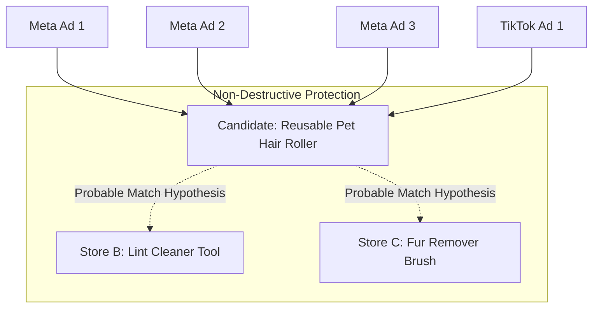

# SWAI KH-02 — Product Identity & Candidate Deduplication Architecture
**Document ID:** `KH02_02_PRODUCT_IDENTITY`  
**Module:** KH-02 — Evergreen Winning Products Intelligence (V12.0)  
**Date:** October 26, 2026  
**Status:** IMPLEMENTED  

---

## 1. Executive Summary

A critical failure mode in competitor research systems is **ad fragmentation** (treating 60 different ad creatives for the same product as 60 separate products) or **destructive over-merging** (silently collapsing different competitors' products into one database SKU because they use similar words).

SWAI KH-02 resolves this through a three-layer identity model:
1. **Ad Level (`CompetitorAd`):** Individual marketing variants, captions, and library IDs.
2. **Product Candidate Level (`DiscoveredProductCandidate`):** Consolidated product representation grouping all ads sharing a canonical destination.
3. **Cross-Platform Hypothesis Level (`ProductMatchHypothesis`):** Probable associations across different competitor stores or social platforms, strictly requiring manual review before any cross-store union.

---

## 2. Product Extraction & Grouping Rules (`productCandidateDiscovery.ts`)

### 2.1 Canonical URL Grouping
- All ad landing page URLs are stripped of query tracking parameters (`utm_*`, `fbclid`, `ref`, session tokens, anchors).
- Ads sharing the exact same canonical path on a verified domain are grouped into a single `DiscoveredProductCandidate`.

### 2.2 Title & Problem Statement Cleaning
- Slogans, sale tags (`50% Off`, `Free Shipping`), and call-to-action hooks (`Shop Now`) are automatically stripped from product titles.
- Problem statements are extracted directly from ad copy using regex problem-solution patterns (`"tired of..."`, `"easily removes..."`, `"designed to solve..."`).

### 2.3 Evidence Confidence Tiering
- `EXACT`: Canonical product URL pointing to a confirmed storefront `/products/` page.
- `PROBABLE`: Confirmed store domain with standard e-commerce slug structure.
- `AMBIGUOUS`: Generic store homepage or multi-product category collection.

---

## 3. Cross-Platform Matching & Review Rules (`crossPlatformProductMatcher.ts`)

### 3.1 Non-Destructive Cross-Store Matching
- When two listings across different domains share functional similarity (e.g. `reusable pet hair roller`), they are classified as **`PROBABLE`**.
- **Hard Safety Invariant:** Two products from different stores are **never automatically merged** into a single `ResearchProduct`.
- The matching hypothesis is flagged with `requiresManualReview: true`.

### 3.2 Human Review Operations
The system provides a review interface allowing researchers to:
1. `CONFIRM`: Verify that Store A and Store B are selling the identical white-label or branded item.
2. `REJECT`: Mark listings as distinct or competing substitutes.
3. `UNCERTAIN`: Keep items independent while retaining linkage as related competitive intelligence.

---

## 4. Verification Checkpoint

The identity services are implemented in:
- `src/services/kh02/identity/productCandidateDiscovery.ts`
- `src/services/kh02/identity/crossPlatformProductMatcher.ts`

Phase 2 requirements are fulfilled.
