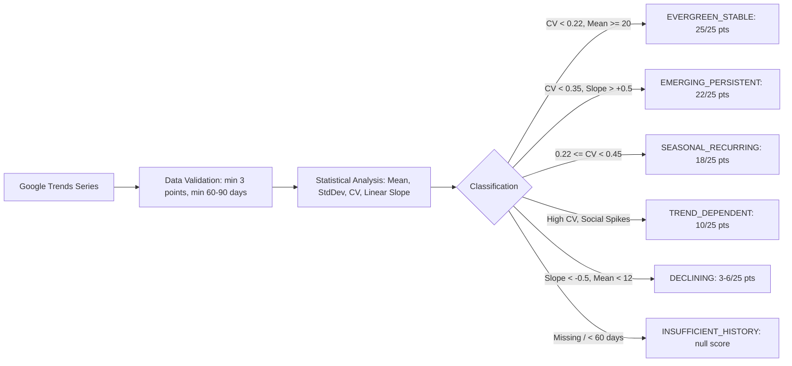

# SWAI KH-02 — Temporal Demand Engine & Seasonality Analysis
**Document ID:** `KH02_03_DEMAND_ENGINE`  
**Module:** KH-02 — Evergreen Winning Products Intelligence (V12.0)  
**Date:** October 26, 2026  
**Status:** IMPLEMENTED  

---

## 1. Executive Summary

SWAI KH-02 rejects the premise that raw viral view count indicates commercial sustainability. True evergreen products solve persistent customer problems over months and years, exhibiting predictable demand curves and stable search intent.

The Temporal Demand Engine evaluates historical time series (Google Trends relative index $0-100$) across 30D, 90D, 180D, and 365D observation windows.

---

## 2. Statistical Metrics & Mathematical Formulations

### 2.1 Mean & Volatility
- **Mean Relative Interest ($\mu$):**
  $$\mu = \frac{1}{N} \sum_{i=1}^N x_i$$
- **Standard Deviation ($\sigma$):**
  $$\sigma = \sqrt{\frac{1}{N} \sum_{i=1}^N (x_i - \mu)^2}$$
- **Coefficient of Variation ($CV$):**
  $$CV = \frac{\sigma}{\mu}$$

### 2.2 Trend Velocity (Linear Regression Slope)
To distinguish between flat dead products and accelerating emerging categories:
$$m = \frac{N \sum (i \cdot x_i) - \left(\sum i\right)\left(\sum x_i\right)}{N \sum i^2 - \left(\sum i\right)^2}$$
- $m > +0.5$: `ACCELERATING`
- $-0.5 \le m \le +0.5$: `STEADY`
- $m < -0.5$: `DECELERATING`

---

## 3. Strict Rules & Guardrails

1. **Short-Term Quarantine:** A time series covering $< 60$ days is strictly prohibited from receiving an `EVERGREEN_STABLE` classification. It is returned with `demandClass: "INSUFFICIENT_HISTORY"` and `stabilityScore: null`.
2. **Dead Flatline Protection:** Products with a low mean ($\mu < 12$) and low variation ($\sigma < 4$) are classified as `DECLINING`. Flatlining at zero search volume is not evergreen stability.
3. **Seasonal Distinction:** Moderate variance ($0.22 \le CV < 0.45$) is classified as `SEASONAL_RECURRING` (18 points), preventing seasonal items from claiming year-round stability.
4. **Zero Data Fabrication:** If no time series data exists for a candidate, the system never interpolates or fabricates points. The score remains `null` and confidence is penalized.

---

## 4. Verification Checkpoint

The temporal demand engine is implemented in:
- `src/services/kh02/demand/temporalDemandEngine.ts`

Phase 3 requirements are fulfilled.
