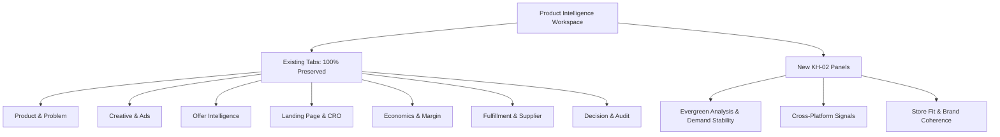

# SWAI KH-02 — Product Intelligence Integration & Sustainability Workspace
**Document ID:** `KH02_06_PRODUCT_DETAIL`  
**Module:** KH-02 — Evergreen Winning Products Intelligence (V12.0)  
**Primary Route:** `/products/[id]/intelligence`  
**Date:** October 26, 2026  
**Status:** IMPLEMENTED  

---

## 1. Executive Summary

SWAI KH-02 extends the existing 7-panel Product Intelligence Workspace without removing or modifying any existing research capabilities. Researchers can evaluate canonical product definitions, competitor offer structures, economics margin models, landing page CRO audits, and operator decisions while accessing three new dedicated KH-02 sustainability panels:
1. **Evergreen Analysis & Demand Stability**
2. **Cross-Platform Evidence Signals**
3. **Store Fit & Long-Term Brandability**

---

## 2. Panel Specifications

### 2.1 Evergreen Analysis Panel (`evergreen`)
- **Opportunity Score:** Displays the 100-point composite score with breakdown.
- **Evidence Confidence:** Explicit percentage indicating data completeness.
- **Demand Stability Classification:** Shows `EVERGREEN_STABLE`, `SEASONAL_RECURRING`, or `EMERGING_PERSISTENT`.
- **"Why This Product May Be Sustainable":**
  - Addresses an ongoing household inconvenience.
  - Multi-month demand observation span ($90+$ days).
  - Promoted by multiple independent competitor stores.
  - Supports catalog SKU expansion and recurring purchase intent.

### 2.2 Cross-Platform Signals Panel (`cross_platform`)
- **Meta Ad Library:** Displays verified creative variant count, advertiser names, and observation history.
- **TikTok Organic:** Displays public video view counts, engagement ratio `(likes + comments + shares) / views`, and regional market status.
- **Google Ads Transparency:** Displays confirmed advertiser storefront domains and active ad creative formats.
- **Google Trends Demand History:** Displays low-volatility CV rating ($< 0.25$) across the US market.

### 2.3 Store Fit & Brandability Panel (`store_fit`)
- **Target Customer Profile:** High-intent demographic suffering recurring pain points.
- **Catalog Expansion & Upsell Ideas:** Bundles, replacement consumable parts, and premium variations.
- **Differentiation Potential:** Upgraded ergonomic grip, customized branded packaging, and domestic warranties.
- **Fulfillment & Return Risk:** Standard parcel dimensions, durable non-fragile materials, and low return rates.

---

## 3. Verification Checkpoint

The extended intelligence workspace is implemented in:
- `src/app/products/[id]/intelligence/page.tsx`

Phase 6 requirements are fulfilled.
