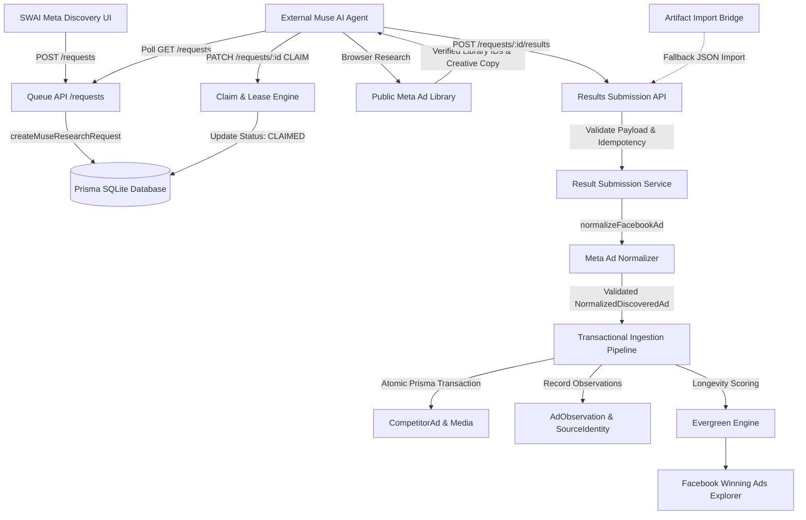

# SWAI V10 — Muse AI & Meta Ads Discovery Architecture

This document details the end-to-end data flow, service boundaries, and state transitions for the Meta/Facebook Ads discovery subsystem in SWAI.

---

## 1. System Architecture Overview

---

## 2. Core Service Components

### 2.1 `src/services/discovery/muse/museRequestService.ts`
- Creates `DiscoveryRun` and associated `SyncJob` with platform `META` and provider `muse-ad-library`.
- Enforces keywords validation, market normalization (US), and rate-limiting.
- Implements atomic claiming with 15-minute lease expiration.
- Enforces valid status transitions: `PENDING` -> `CLAIMED` -> `RUNNING` -> `COMPLETED`. Reopening terminal states is rejected.

### 2.2 `src/services/discovery/normalization/normalizeFacebookAd.ts`
- Validates Meta Library ID as numeric string (at least 5 digits). Rejects malformed or synthetic IDs.
- Generates canonical URL `https://www.facebook.com/ads/library/?id=<libraryId>`.
- Generates stable composite hash `SHA256("META:muse-ad-library:<libraryId>")`.
- Safely validates external URLs (prevents SSRF and invalid schemes like `javascript:` or `file:`).
- Preserves media type honesty (`VIDEO`, `IMAGE`, `CAROUSEL`, `UNKNOWN`). Never defaults to `VIDEO`.
- Rejects financial claims (ROAS, spend, revenue).

### 2.3 `src/services/discovery/muse/museResultSubmissionService.ts`
- Zod schema validation of incoming research batches.
- Database-backed idempotency: duplicate `submissionId` calls return cached result without duplicating observations.
- Handles legitimate zero-result searches (`COMPLETED_EMPTY`).
- Records provider request ledger with zero API cost ($0.00).

### 2.4 `src/services/discovery/discoveryIngestionService.ts`
- Resolves `DataSource`: `META_AD_LIBRARY` for Meta, `TIKTOK_CREATIVE_CENTER` for TikTok.
- Cross-platform ID isolation: prevents `externalAdId` collisions across platforms.
- Atomic identity lookup by `stableIdentityHash` first.
- Transaction-safe outcome counting: counters increment only after transaction commit.
- Calculates initial Evergreen classification.

---

## 3. State Machine Transitions

| Current State | Target State | Condition / Method |
| :--- | :--- | :--- |
| `PENDING` | `CLAIMED` | External agent claim with active 15m lease. |
| `CLAIMED` | `RUNNING` | Heartbeat update or research in progress. |
| `RUNNING` | `COMPLETED` | Successful result submission via results endpoint. |
| `RUNNING` | `PARTIALLY_COMPLETED` | Batch contains both valid and invalid records. |
| `RUNNING` | `FAILED` | All submitted records invalid or explicit failure patch. |
| `PENDING` / `CLAIMED` | `CANCELLED` | Explicit user cancellation. |
| `CLAIMED` (expired) | `PENDING` / `CLAIMED` | Lease expired > 15m; eligible for reclaim. |
| `COMPLETED` | *Any* | **Forbidden** (immutable terminal state). |
