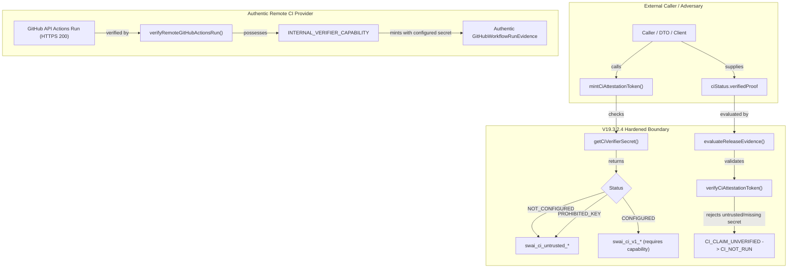

# SWAI KH-02 — V12.4.3.7.19.3.2.4
## Baseline, Target Scope, Callgraph & Root Cause Analysis

### 1. Provenance & Baseline Anchor
- **Repository**: `quocan050302/Shopify-Search`
- **Locked Branch**: `feature/kh02-walmart-us-jina-reader-v12.4.3.5.1`
- **Baseline Commit (C0)**: `76c3de8adefc6995cdf5728753450d186abfc0de`
- **Baseline Tree**: `32dbfb575b9561d32c172b84d38ab7eab59013c5`
- **Tested Implementation Commit (C1)**: `1e463304b5552f996d0732b1a21ae6bbf927efb6`
- **Tested Implementation Tree**: `1fdf79e3deba7c608de01c3f9408d869122ba1a6`
- **Remote HEAD Status**: Synchronized fast-forward ancestry on locked branch.

### 2. P0 Root Cause Analysis
In V19.3.2.3, cryptographic HMAC signing was introduced via `mintCiAttestationToken` and `verifyCiAttestationToken` in `src/services/kh02/release/githubActionsCiEvidence.ts`. However, three critical trust boundary defects existed:
1. **Hardcoded Fallback Secret**: `DEFAULT_CI_VERIFIER_KEY = "SWAI_KH02_INTERNAL_HMAC_VERIFIER_KEY_V19_3_2_3_SECURE"` was exported and used whenever `process.env.KH02_CI_VERIFIER_SECRET` was absent.
2. **Unrestricted Minting Export**: `mintCiAttestationToken()` was exported publicly without capability restriction, allowing any caller to mint valid HMAC tokens for arbitrary fabricated GitHub Action payloads.
3. **Release Evaluator Elevation**: `evaluateReleaseEvidence()` in `releaseGateEvaluatorV19.ts` accepted caller-supplied `verifiedProof` objects with valid signatures and promoted `ciStatus` to `CI_PASS`, bypassing authentic GitHub API interactions.

### 3. Exact Callgraph & Target Symbols

### 4. Public Symbols & Callsite Inventory
- `DEFAULT_CI_VERIFIER_KEY`: **COMPLETELY REMOVED** from codebase and exports.
- `KNOWN_INSECURE_DEFAULT_KEYS`: Added denylist rejecting known default/weak keys.
- `getCiVerifierSecret()`: Privileged server-only accessor enforcing `NOT_CONFIGURED` / `INSECURE_OR_DEFAULT`.
- `mintCiAttestationToken()`: Protected minting function; returns untrusted token when called outside verified provider capability.
- `verifyCiAttestationToken()`: Enforces constant-time HMAC check against `getCiVerifierSecret().key`; rejects untrusted prefixes and missing secrets.
- `verifyAuthenticCiProof()`: Strictly enforces attestation token verification before claim acceptance; quarantines unit mocks.
- `evaluateReleaseEvidence()`: Demotes unverified CI claims to `CI_NOT_RUN` with blocker `CI_CLAIM_UNVERIFIED`; records `CI_NOT_CONFIGURED` blocker when CI is unconfigured.
