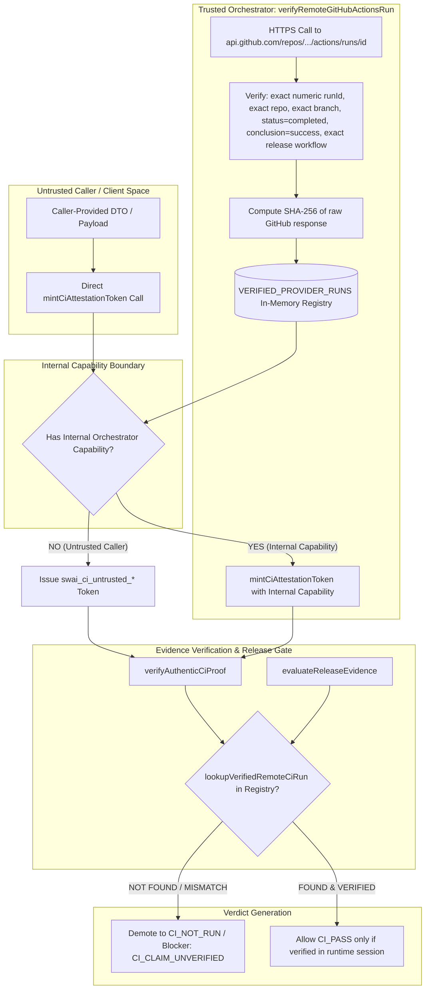

# SWAI KH-02 — V12.4.3.7.19.3.2.5
## Baseline Anchors and Authentic CI Trust Callgraph

### 1. Immutable Baseline & Commit Anchors

- **Repository**: `quocan050302/Shopify-Search`
- **Locked Branch**: `feature/kh02-walmart-us-jina-reader-v12.4.3.5.1`
- **Baseline Commit (C0)**: `4a1d54a4af34c5814c62c5f488e25fb97b28ffa5`
- **Tested Code Commit (C1)**: `8db28deb38fc06fa4d50881d1436596fd8b223eb`
- **Tested Code Tree SHA**: `da79e95864faab01f44d5d629059136e178ba5a5`
- **Evidence/Docs Commit (C2)**: Pending (this commit)
- **Patch Objective**: Close the CI origin forgery vulnerability where callers with HMAC secrets could forge `CI_PASS` proofs without authentic remote execution, and establish a bounded, deterministic async DAG gate runner.

---

### 2. Threat Model: Caller-Asserted CI Forgery

In V19.3.2.4 and earlier versions:
1. `mintCiAttestationToken` was a public pure utility accepting any `GitHubWorkflowRunEvidence` dictionary and signing it using HMAC-SHA256 with `KH02_CI_VERIFIER_SECRET`.
2. Any test, external module, or caller script knowing the secret could create an in-memory dictionary with `source: "GITHUB_API"`, `verifier: "SWAI_TRUSTED_GITHUB_VERIFIER_V1"`, and a well-formed 64-hex `responseDigest`.
3. `verifyAuthenticCiProof` and `evaluateReleaseEvidence` verified only that the HMAC signature was cryptographically valid against the digest.
4. If valid, the evaluator elevated `ciStatus` to `CI_PASS`, creating the false appearance of verified remote GitHub Actions execution when no HTTP request ever reached `api.github.com`.

---

### 3. Closed Trust Architecture Callgraph

---

### 4. Enforcement Mechanisms

1. **Registry Requirement**: Every valid CI claim MUST exist in `VERIFIED_PROVIDER_RUNS`, keyed by `canonical_repo#runId`.
2. **Capability Token**: Only code possessing `TRUSTED_ORCHESTRATOR_CAPABILITY` (a process-private Symbol) can register runs or mint authoritative tokens. Calls without capability receive `swai_ci_untrusted_*`.
3. **Double Verification in Gate Evaluator**: `evaluateReleaseEvidence` directly invokes `lookupVerifiedRemoteCiRun(runId, testedCodeSha, repository)`. Even if a caller passes a syntactically valid attestation token, the evaluator fails closed with `CI_NOT_RUN` and blocker `CI_CLAIM_UNVERIFIED`.
4. **Bypass Elimination**: Removed the dangerous `requireTrustedVerifier === false` bypass from `verifyGitHubActionsRunProof` in `testSuiteEvidenceValidator.ts`.
5. **Exact Numeric runId**: Verified that `data.id === runIdStr` to prevent ID mismatch attacks.
6. **Exact Workflow Matching**: Substring matching eliminated. Workflows must strictly match `CANONICAL_RELEASE_WORKFLOWS`.
