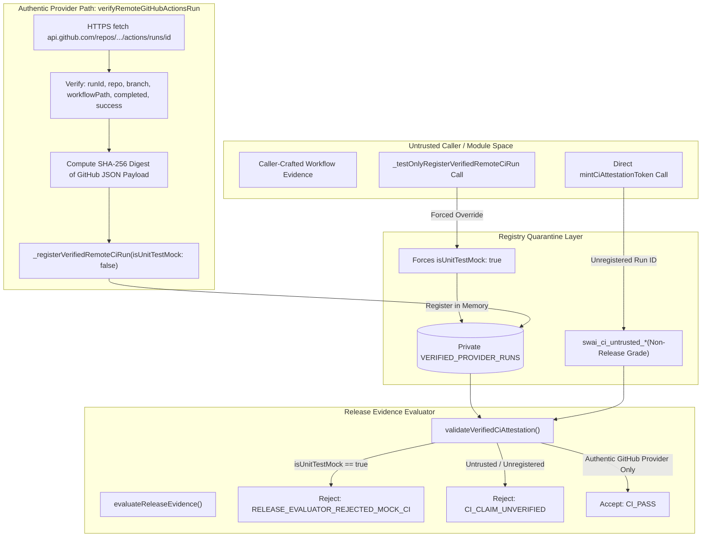

# SWAI KH-02 — V12.4.3.7.19.3.2.6
## Baseline Anchors, CI Trust Boundary, and Callgraph Audit

### 1. Immutable Baseline & Commit Anchors

- **Repository**: `quocan050302/Shopify-Search`
- **Locked Branch**: `feature/kh02-walmart-us-jina-reader-v12.4.3.5.1`
- **Baseline Commit (C0)**: `b96c4b903d9e4eaa59ed81944d5ec0a407fab697`
- **Baseline Tree SHA**: `f7c5245022cc3e1ed45c23849f46a166b80bd7e3`
- **Tested Code Commit (C1)**: `fe03d6a0915d86111bcad3dcdef7ded2ebbae90d`
- **Tested Code Tree SHA**: `64a8577a4e924a45ab956aa9659af0b05564629d`
- **Evidence & Release Commit (C2)**: Pending (this commit)
- **Patch Objective**:
  1. Eliminate forgeable CI origin registration capability (`TRUSTED_ORCHESTRATOR_CAPABILITY` removed).
  2. Make the CI provider run registry strictly private (`_registerVerifiedRemoteCiRun`), restricting test registration to explicit quarantine (`_testOnlyRegisterVerifiedRemoteCiRun` forcing `isUnitTestMock: true`).
  3. Reorder validation checks in `lookupVerifiedRemoteCiRun` so syntax/workflow/repo/branch/conclusion/status rules evaluate strictly before mock checks.
  4. Implement bounded, fail-closed async DAG gate runner with real Darwin memory check (`vm_stat`), log ring-buffering, and serialized DB execution.
  5. Execute zero-cost targeted free-source MCP smoke verification.

---

### 2. Threat Model: Elimination of Forgeable CI Registry & Capability

In V19.3.2.5 and previous iterations:
1. `TRUSTED_ORCHESTRATOR_CAPABILITY` was exported as a `Symbol.for(...)` token, allowing any internal or external module to import or re-create the capability and sign CI attestation tokens directly.
2. `registerVerifiedRemoteCiRun` was exported, permitting tests or callers to insert arbitrary unverified workflow runs into the in-memory registry.
3. Callers could pass `isUnitTestMock: false` to mock registration helpers, effectively minting release-grade CI proofs without actual GitHub API execution.

In V19.3.2.6:
1. `TRUSTED_ORCHESTRATOR_CAPABILITY` is completely eliminated.
2. `_registerVerifiedRemoteCiRun` is private and unexported. Only `verifyRemoteGitHubActionsRun` (the authentic orchestrator performing genuine HTTPS fetch to `api.github.com`) can call it.
3. `_testOnlyRegisterVerifiedRemoteCiRun` is strictly quarantined: it forces `isUnitTestMock: true` regardless of caller input or environment.
4. Direct calls to `mintCiAttestationToken` without registry backing return untrusted tokens prefixed with `swai_ci_untrusted_*`.
5. Release evaluator rejects all mock or untrusted tokens with `RELEASE_EVALUATOR_REJECTED_MOCK_CI` or `UNTRUSTED_TOKEN`.

---

### 3. Closed Trust Architecture Callgraph

