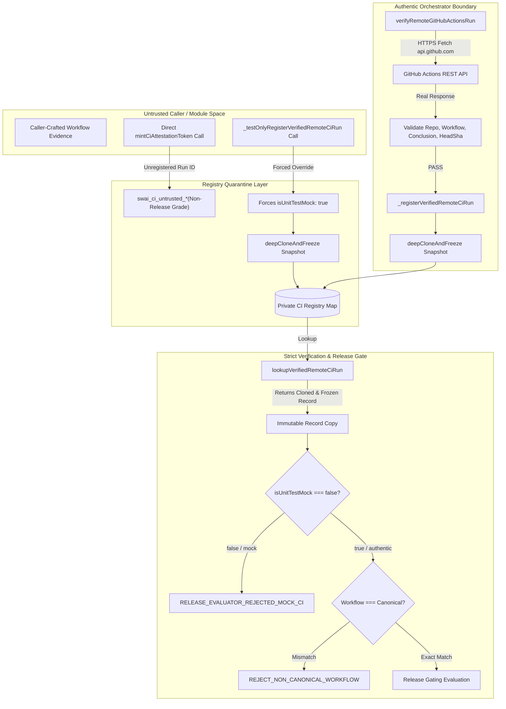

# SWAI KH-02 — V12.4.3.7.19.3.2.7
## Baseline Anchors, CI Trust Boundary, and Callgraph Audit

### 1. Immutable Baseline & Commit Anchors

- **Repository**: `quocan050302/Shopify-Search`
- **Locked Branch**: `feature/kh02-walmart-us-jina-reader-v12.4.3.5.1`
- **Baseline Commit (C0)**: `1152810c5b0632ff0f73c55b4327cf216bc69312`
- **Baseline Tree SHA**: `c0184fddfd59a4580fdd119900706e91418b4052`
- **Tested Code Commit (C1)**: `63555f847761dc96fa39042706007022fae56e00`
- **Tested Code Tree SHA**: `3c5b78cb645ae75e0f639247418d8e319f77d627`
- **Evidence & Release Commit (C2)**: Pending (this commit)
- **Patch Objective**:
  1. Close mutable registry reference leak: `lookupVerifiedRemoteCiRun` and `_registerVerifiedRemoteCiRun` return deep-cloned and frozen objects (`Object.freeze`) and opaque proof handles.
  2. Eliminate unrestricted signer exports: remove `_privateMintCiAttestationToken` export, remove `testKey` option from `mintCiAttestationToken`, and isolate test fixture signer to `tests/setupTestEnvironment.ts`.
  3. Enforce exact workflow allowlisting: replace substring matching with strict exact equality check (`===`) across `verifyAuthenticCiProof` and `evaluateReleaseEvidence`.
  4. Typed gate output validators: validate Vitest summary counts, E8 backtest JSON, E9 DB readback, and E10 remote CI diagnostic fail-closed.
  5. Genuine zero-cost stdio MCP smoke: execute real stdio JSON-RPC handshake (`createGoogleTransparencyMcpClient`) discovering tools with `providerVerified: false` at $0.00 spend.

---

### 2. Threat Model: Mutable Registry Reference & Unrestricted Signer Removal

In V19.3.2.6 and prior iterations:
1. `lookupVerifiedRemoteCiRun` returned a direct object reference to the internal registry map. A malicious caller or errant test could mutate `rec.isUnitTestMock = false`, `rec.conclusion = "success"`, or `rec.status = "completed"` directly on the cached object in memory.
2. `_privateMintCiAttestationToken` was exported publicly from `githubActionsCiEvidence.ts`, allowing any caller to mint arbitrary valid HMAC attestation tokens without registering with the authentic orchestrator.
3. `mintCiAttestationToken` accepted an optional `testKey` argument, which bypassed production secret boundaries.
4. Workflow matching used `.includes()` or prefix matching, allowing spoofed workflows like `fake-kh02-ci.yml` or `.github/workflows/kh02-ci.yml.attacker` to pass.

In V19.3.2.7:
1. `deepCloneAndFreeze` enforces immutable registry snapshots. Both `_registerVerifiedRemoteCiRun` and `lookupVerifiedRemoteCiRun` clone and recursively freeze all fields. Modifying the returned object throws a `TypeError` in strict mode or has zero effect on the internal registry.
2. `_privateMintCiAttestationToken` is module-private (unexported).
3. `testKey` parameter is completely removed from `mintCiAttestationToken`.
4. Dedicated test fixture signer `testMintCiAttestationToken` is isolated inside `tests/setupTestEnvironment.ts` and exclusively used for isolated unit test fixtures.
5. Exact equality (`===`) is enforced for workflow allowlisting against `CANONICAL_RELEASE_WORKFLOWS`.

---

### 3. Closed Trust Architecture Callgraph

